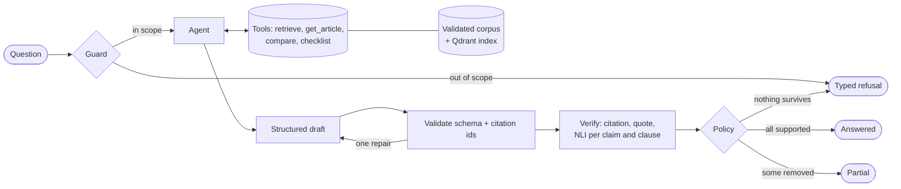

# CiteShield

**A research agent for EU digital regulation that cites the exact paragraph behind every
claim, checks each claim against the official text before showing it, and refuses when the
evidence is not there.**

Ask about the GDPR, AI Act, DSA, NIS2 or Data Act. CiteShield searches the official texts,
drafts a structured answer in which every claim carries a paragraph-level citation and a
verbatim quote, then verifies the citation, the quote and the entailment of each claim. It
removes what fails and marks the answer partial, or returns a typed refusal.

> **Local demonstration project.** The demo runs on your own Windows machine with a local
> model (Ollama `qwen3:4b`): no API key, no paid calls, **no hosted demo**. It gives
> experimental legal information, not legal advice or a compliance certification.

[Quickstart](#quickstart-windows) · [How answers work](#how-answers-work) ·
[Results](#selected-results) · [Limitations](#limitations-and-security-caveats) ·
[Documentation](#documentation) · [Release notes](RELEASE.md)

## Why it is interesting

- **The model never decides whether it is right.** Citation validity, verbatim-quote
  matching and entailment are computed from the canonical corpus and a local NLI model, per
  claim *and* per coordinated clause. Verification can only lower an answer's status.
- **Citations are checkable by construction.** The agent can only cite chunks its own tools
  returned in this run; fabricated ids, wrong versions, untrusted sources and unretrieved
  provisions are rejected.
- **Refusal is a first-class outcome.** Out-of-scope questions, personal legal advice,
  instruction-change attempts and thin evidence produce a typed, explained refusal.
- **Evaluation is honest about its limits.** Every run records its identity (models,
  prompts, configs, corpus, git commit); non-comparable runs are refused, failures are never
  counted as refusals, and the reported numbers carry their denominators.

## Capabilities and stack

| area | what is implemented |
|---|---|
| Ingestion | Official Journal XHTML → one validated chunk per paragraph, three-stage data contract, quarantine with reasons |
| Retrieval | `BAAI/bge-m3` dense + sparse vectors in embedded Qdrant, RRF fusion, `BAAI/bge-reranker-v2-m3`; binding text ranked, recitals attached as context |
| Agent | LangGraph state machine with four allowlisted read-only tools; answer, compare and checklist modes; structured Pydantic `AgentAnswer` |
| Verification | citation and quote checks, DeBERTa-v3 NLI entailment per claim and clause, refusal policy |
| Interfaces | FastAPI with Server-Sent Events, a dependency-free browser UI, a CLI |
| Evaluation | 151-question golden set, deterministic metrics, over-refusal and adversarial scoring, LLM-judge calibration |
| Engineering | uv, pytest, ruff, mypy, GitHub Actions security gate, Docker; optional MLflow and Langfuse |

**LLM providers.** The same graph, tools and verifier run on either backend:

| configuration | models | cost | status |
|---|---|---|---|
| **Local demo** (`scripts/start-demo.ps1`, forces `CITESHIELD_LLM__PROVIDER=ollama`) | `qwen3:4b` via Ollama for every call | none | used for every reported answer result |
| Anthropic (the code default when no provider is set) | guard `claude-haiku-5-5`, agent and draft `claude-sonnet-5-5` | paid API, needs `ANTHROPIC_API_KEY` | implemented, **not evaluated**: no Claude run or baseline exists |

## Architecture



Details: [docs/architecture.md](docs/architecture.md).

## Quickstart (Windows)

Requirements:

- Windows with Python 3.12 and the `py` launcher;
- [Ollama](https://ollama.com) installed and running;
- about 8 GB of free RAM while the demo runs (one question at a time). The retrieval and
  NLI models run on CPU; an NVIDIA GPU makes Ollama and indexing much faster;
- about 15 GB of disk, measured on the development machine: 7.3 GB of Hugging Face models
  (downloaded on first start), about 2.5 GB for `qwen3:4b`, and 4.5 GB for the Python
  environment with CUDA PyTorch.

In PowerShell, from the repository folder:

```powershell
py -m pip install uv
py -m uv sync --extra ml
ollama pull qwen3:4b
py -m uv run citeshield-index
powershell -ExecutionPolicy Bypass -File scripts\start-demo.ps1
```

1. `uv` is called as `py -m uv`, so it does not need to be on `PATH`.
2. `uv sync --extra ml` installs the app, torch (CUDA wheels on Windows) and the test tools.
3. `citeshield-index` builds `data/index` from the committed corpus once (a few minutes).
4. `start-demo.ps1` checks uv, the corpus, the index, Ollama, the model and free RAM, then
   serves http://127.0.0.1:8000 (loopback only) and opens the browser. Options:
   `-Port 8080`, `-NoBrowser`.

The models take one to two minutes to load; the status indicator turns green
(*Ready · Local · qwen3:4b*) when the server can answer, and red with the reason if startup
fails. A local answer takes about 1–5 minutes.

To run the deterministic test suite (no models, keys or index needed):

```powershell
py -m uv run pytest
```

**Docker (optional, CPU).** With Docker Desktop running, Ollama with `qwen3:4b` on the
host and the index built as above:

```powershell
docker compose up --build -d          # http://127.0.0.1:8000; first start downloads ~7.7 GB of models
docker compose down
py -m uv run python scripts/docker_smoke.py                         # container smoke test (no models)
powershell -ExecutionPolicy Bypass -File scripts\docker-e2e.ps1     # one real question through the container
```

**CI.** Every pull request runs ruff, mypy, the blocking security and verification gate,
the full deterministic suite, a Docker build (not pushed) and the container smoke test.
None of these calls a model, so they do not show answer quality. There is no deployment
stage.

Docker details, what each test proves, troubleshooting, CI and observability are in
[docs/development.md](docs/development.md); the evaluation commands are in
[docs/evaluation.md](docs/evaluation.md#commands).

## How answers work

Choose a mode (*Answer*, *Compare* or *Checklist*), type or pick an example question,
optionally limit the regulations, and press *Research*. The research trace streams live
beside the answer: the scope check, each tool call with the provisions it returned,
drafting and repairs.

| mode | example question | a good answer |
|---|---|---|
| answer | Within how many hours must a controller notify a personal data breach to the supervisory authority? | Without undue delay and, where feasible, within 72 hours, citing GDPR Art. 33(1) |
| answer | What conditions apply to consent, and can a data subject withdraw it? | Consent can be withdrawn at any time; withdrawal does not affect earlier lawful processing (GDPR Art. 7(3)) |
| compare | Compare the deadlines for reporting a personal data breach under the GDPR with significant incident reporting under NIS2. | GDPR 72 hours (Art. 33(1)) against NIS2 early warning in 24 h and notification in 72 h (Art. 23(4)) |
| checklist | Give me a checklist of the obligations of providers of high-risk AI systems. | Items from AI Act Art. 16, each with a citation |
| answer | What is the corporate income tax rate in Ireland? | Refused before any research: outside the covered law |

Every answer has one of three outcomes:

- **Answered.** Each claim (or checklist item) shows a verbatim quote and its citation.
  Clicking a citation opens the full official paragraph with the legal act, CELEX number,
  version, citation id and an EUR-Lex link. Compare mode groups claims by regulation;
  checklist mode shows a table of obligations and who each applies to.
- **Partial.** Some claims failed verification (wrong citation, quote not in the source, or
  not entailed by it) and were removed. What remains is verified, and the answer says so.
- **Refused.** The question is out of scope, asks for advice on the user's own situation,
  tries to change the assistant's instructions, or the evidence is too thin or contradictory.
  The refusal carries a typed reason (`out_of_scope`, `insufficient_evidence`,
  `unsupported_claims`, …) and a plain-language explanation.

qwen3:4b is small and varies from run to run: expect some partial answers and the
occasional unnecessary refusal.

## Selected results

All figures are single runs on small sets, from committed result files; they are
descriptive, not statistical evidence. Each table names its question set; the sets are
described in [docs/evaluation.md](docs/evaluation.md#question-sets).

**Retrieval** — 60-question retrieval benchmark from Milestone 3 (q001–q060 of the golden
set; ranking metrics over its 53 answerable questions), default configuration
([report](eval/results/retrieval_latest.md)):

| metric | hybrid + rerank, recitals as context | hybrid + rerank, recitals ranked |
|---|---|---|
| hit@1 (top result is an expected provision) | **0.811** | 0.377 |
| recall@8 (expected provisions in the top 8, mean per question) | 0.975 | 0.928 |
| MRR@20 | 0.886 | 0.624 |

The reranker preferred recitals' explanatory prose over the binding article; ranking only
binding text fixed that. This benchmark predates the 151-question golden set and was not
re-run on it.

**Local answers and refusals** — `qwen3:4b`, 14-question local subset (11 answerable,
3 to refuse), run `ollama-local-m7-salvage-2`
([report](eval/results/milestone7_over_refusal.md)):

| metric | result | denominator |
|---|---|---|
| coverage (answered or partial) | 8/11 | answerable questions |
| over-refusal | 1/11 | answerable questions |
| invalid output (draft never became a valid answer) | 2/11 | answerable questions |
| correct refusal / under-refusal | 3/3 / 0/3 | questions that should be refused |
| faithfulness (verifier support ratio of the draft) | 0.889 | mean over the 9 questions with a verified draft |
| citation precision (share of a question's cited chunks matching an expected provision) | 0.729 | mean over the 8 answerable questions with citations |
| context recall (share of a question's expected provisions retrieved) | 0.955 | mean over the 11 answerable questions |

Most of the citation-precision gap is citations of relevant paragraphs outside the golden
set's expected list. One claim was only partly supported; the coordinated-clause check added
afterwards targets that defect.

**Adversarial (preliminary)** — 5 synthetic poisoned-content cases injected into tool
output ([report](eval/results/milestone7_adversarial.md)). With all defenses on, no
pre-registered attack succeeded across 9 delivered samples, but one answer still carried a
provision reference invented by the payload. With all defenses off, the refusal-induction
payload succeeded (1 of 5 cases). Only 2 of 6 defense-ablation profiles are complete, 1 is
partial and 3 were not run. **This is not evidence of general prompt-injection
resistance.**

**LLM judge** — the local `qwen3:4b` judge **failed calibration** against 30 held-out
human labels on every answer grade (best held-out kappa 0.694, target ≥ 0.7). It is
informational only ([report](eval/results/judge_calibration.md)).

**Tests** — the deterministic suite and the blocking CI security gate use scripted LLMs;
they check the pipeline's rules, not model quality. Release results are in
[RELEASE.md](RELEASE.md#tests-and-deterministic-evaluation).

## Limitations and security caveats

- **Small, single-run evidence.** Answer quality comes from 14 questions with one local
  model; there is no Claude evaluation and no calibrated judge, so no automatic
  model-quality gate has run.
- **Provisional thresholds.** The NLI thresholds come from 60 author-labelled pairs, the
  retrieval-score refusal threshold from the 60-question benchmark.
- **Golden-set review.** q061–q151 and the reference answers of q001–q053 still need a human
  review; labels come from one annotator, the project author.
- **Verification has gaps.** The clause check covers explicit coordination only; an
  unsupported qualifier inside one clause can pass if the NLI model accepts the sentence.
  References to nonexistent provisions can reach the user through summary sentences.
- **Prompt injection.** Delimiters and the prompt warning are prompt-level defenses. The
  adversarial testing is preliminary, the ablations are incomplete, and the guard and tool
  allowlist were not attacked.
- **Local model behaviour.** qwen3:4b varies between runs, can produce invalid outputs
  (2/11 in the last run), and is slow (1–5 minutes per answer).
- **Resources.** On a 16 GB laptop, free RAM fell to about 115 MB during evaluations; the
  demo needs about 8 GB free. The Docker deployment (CPU only) was verified end to end with
  a single question, not evaluated.
- **Not legal advice.** Only the texts published in the Official Journal of the European
  Union are authentic.

The full list, including what would complete the original goals, is in
[RELEASE.md](RELEASE.md#known-limitations).

## Documentation

| document | contents |
|---|---|
| [RELEASE.md](RELEASE.md) | 0.1.0 status: feature table, verified results with definitions, live smoke test, adversarial table, known limitations |
| [docs/architecture.md](docs/architecture.md) | providers, agent graph, verification and refusal policy, ingestion data contract, retrieval |
| [docs/evaluation.md](docs/evaluation.md) | question sets, commands, metric definitions, retrieval benchmark, judge calibration, model-quality gate |
| [docs/development.md](docs/development.md) | tests and opt-in suites, CI, Docker (Compose, smoke and end-to-end tests), MLflow and Langfuse, rebuilding the corpus |
| [eval/results/](eval/results/) | the detailed evaluation reports |

## License

CiteShield's original project code is released under the [MIT License](LICENSE),
Copyright (c) 2026 Shubham Vijay Kawde.

The MIT License covers only that original code. Everything else stays under its own
license and terms, and the MIT License does not override them:

- **EU legal texts.** The regulations and the excerpts derived from them, such as
  `data/processed/chunks.jsonl`, come from EUR-Lex and the Publications Office of the
  European Union. Their reuse is governed by the EU's terms for reusing its documents.
  Only the texts published in the Official Journal of the European Union are authentic.
- **Dependencies.** Python packages are used under their own licenses.
- **Models.** Model weights are downloaded separately and are not part of this repository:
  Ollama `qwen3:4b`, the `BAAI` encoder and reranker, and the NLI model. Each is subject to
  its publisher's license and terms.
- **Third-party services and assets** remain subject to their providers' terms.
